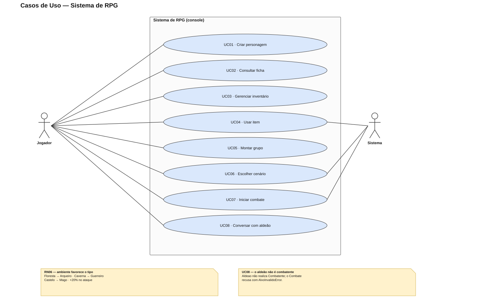

# Caso de Uso — Sistema de RPG (console)

**Disciplina:** Programação Orientada a Objetos — Univassouras
**Escopo:** sistema de console, sem backend (API/HTTP) e sem interface gráfica.
**Ator humano:** Jogador (operador do terminal). Ator secundário: Sistema (executa as regras).

---

## 1. Objetivo

Permitir que um jogador **crie personagens**, **equipe-os com itens**, **organize-os em grupos**,
**escolha um cenário** que favoreça um tipo de personagem e **resolva combates por turnos**
no terminal, com todas as regras de domínio validadas por exceções próprias.

O sistema existe para **demonstrar, em execução, os conceitos de POO** das aulas 01–09:
classes e objetos, atributos/métodos/interação, abstração, interface, herança,
tratamento de exceções, agregação, composição e consumo de classe.

---

## 2. Atores

| Ator | Descrição |
|---|---|
| **Jogador** | Único ator humano. Opera o menu de console. |
| **Sistema** | Executa as regras: valida entradas, aplica bônus de cenário, resolve turnos, lança exceções. |

---

## 3. Diagrama de casos de uso (UML)

O diagrama é entregue em dois formatos equivalentes:

| Arquivo | Uso |
|---|---|
| [`diagrama-casos-de-uso.drawio`](diagrama-casos-de-uso.drawio) | editável no [draw.io](https://app.diagrams.net) / diagrams.net |
| [`diagrama-casos-de-uso.svg`](diagrama-casos-de-uso.svg) | pré-visualização versionada (renderiza no GitHub) |



Leitura do diagrama:

- **Jogador** (ator principal) dispara os oito casos, de **UC01** a **UC08**.
- **Sistema** é ator secundário apenas onde há regra de domínio a executar:
  **UC04** (aplica o efeito do item), **UC06** (aplica o bônus de cenário) e
  **UC07** (resolve turnos, defesa e XP).
- **UC08** está no diagrama para evidenciar a interface: `Aldeao` **não** realiza
  `Combatente`, portanto nunca entra em combate (`AlvoInvalidoError`).
- A fronteira **"Sistema de RPG (console)"** delimita o escopo: sem API, sem banco e sem GUI.

---

## 4. Visão geral dos casos de uso

```
                    +--------------------------------------+
                    |            Sistema de RPG            |
                    |                                      |
   +--------+       |  UC01 Criar personagem               |
   |        |------>|  UC02 Consultar ficha                |
   |Jogador |       |  UC03 Gerenciar inventário           |
   |        |------>|  UC04 Usar item                      |
   +--------+       |  UC05 Montar grupo                   |
                    |  UC06 Escolher cenário               |
                    |  UC07 Iniciar combate                |
                    |  UC08 Conversar com aldeão           |
                    +--------------------------------------+
```

| Código | Caso de uso | Conceitos de POO exercitados |
|---|---|---|
| UC01 | Criar personagem | classes/objetos, abstração, herança, construtor |
| UC02 | Consultar ficha | atributos, encapsulamento, composição |
| UC03 | Gerenciar inventário | composição, exceções, interação |
| UC04 | Usar item | abstração, polimorfismo, interface de uso |
| UC05 | Montar grupo | agregação, exceções |
| UC06 | Escolher cenário | abstração, polimorfismo, regra de negócio |
| UC07 | Iniciar combate | interface, polimorfismo, consumo de classe, exceções |
| UC08 | Conversar com aldeão | interface (contrato não cumprido), segregação |

---

## 5. Casos de uso detalhados

### UC01 — Criar personagem

**Ator:** Jogador
**Pré-condição:** sistema iniciado.
**Pós-condição:** um objeto de `Guerreiro`, `Mago` ou `Arqueiro` passa a existir, com
`FichaDeStatus` e `Inventario` próprios (composição), vida cheia e nível 1.

**Fluxo principal**
1. Jogador escolhe o tipo (`1` Guerreiro, `2` Mago, `3` Arqueiro).
2. Jogador informa o nome.
3. Sistema instancia a subclasse concreta de `Personagem`.
4. Sistema exibe ficha: vida, força, defesa, nível e inventário vazio.

**Fluxos alternativos / exceções**
- A1. Tipo inexistente → `AlvoInvalidoError`; menu é reapresentado.
- A2. Nome vazio → `ValorInvalidoError`.
- A3. `Personagem` **não pode ser instanciada diretamente** (`TypeError` do `ABC`) — a abstração é o contrato.

---

### UC02 — Consultar ficha

**Ator:** Jogador
**Pós-condição:** nenhuma alteração de estado (operação de leitura).

**Fluxo principal**
1. Jogador escolhe o personagem.
2. Sistema exibe nome, tipo, vida/máxima, força, defesa, nível, XP e itens.

**Exceções**
- A1. Não há personagens criados → `ValorInvalidoError` com a mensagem "nenhum personagem criado".

---

### UC03 — Gerenciar inventário

**Ator:** Jogador
**Pré-condição:** personagem existente.
**Pós-condição:** item adicionado, removido ou listado no `Inventario` do personagem.

**Fluxo principal**
1. Jogador escolhe personagem e a operação (adicionar / remover / listar).
2. Ao adicionar, escolhe o tipo de item (Poção, Arma, Armadura) e os parâmetros.
3. Sistema cria o `Item` e o entrega ao `Inventario.adicionar()`.

**Exceções**
- A1. Remover item que não existe → `ItemNaoEncontradoError`.
- A2. Poção com cura ≤ 0, arma/armadura com bônus < 0 → `ValorInvalidoError`.
- **RN03-a:** o `Inventario` é **criado dentro do construtor** do `Personagem`; não pode ser
  transferido para outro personagem (composição).

---

### UC04 — Usar item

**Ator:** Jogador
**Pré-condição:** personagem com o item no inventário.
**Pós-condição:** efeito aplicado (`Pocao` cura; `Arma` soma bônus de ataque; `Armadura` soma defesa) e item consumido quando for poção.

**Fluxo principal**
1. Jogador escolhe personagem, digita o nome do item.
2. Sistema localiza o item (`Inventario.buscar`).
3. Sistema chama `item.usar(personagem)` — **polimorfismo**: cada subclasse de `Item` decide o efeito.
4. Poção é removida do inventário após o uso; arma e armadura permanecem (equipadas).

**Exceções**
- A1. Item ausente → `ItemNaoEncontradoError`.
- A2. Personagem morto não usa item → `PersonagemMortoError`.
- A3. Curar acima da vida máxima → **não é erro**: valor é limitado a `vida_maxima` (RN04-a).

---

### UC05 — Montar grupo

**Ator:** Jogador
**Pré-condição:** pelo menos um personagem criado.
**Pós-condição:** `Grupo` com 0..5 personagens associados.

**Fluxo principal**
1. Jogador informa o nome do grupo (criado se não existir).
2. Jogador adiciona/remove personagens por nome.

**Exceções**
- A1. Grupo já com 5 membros → `GrupoCheioError`.
- A2. Personagem inexistente → `AlvoInvalidoError`.
- A3. Remover quem não está no grupo → `AlvoInvalidoError`.
- **RN05-a (agregação):** os personagens são **criados antes e fora** do grupo; se o grupo for
  dissolvido, os personagens continuam existindo. O `Grupo` apenas referencia.

---

### UC06 — Escolher cenário

**Ator:** Jogador
**Pós-condição:** um `Cenario` concreto selecionado para o próximo combate.

**Fluxo principal**
1. Jogador escolhe `1` Floresta, `2` Caverna, `3` Castelo.
2. Sistema instancia o cenário correspondente e o mantém para o combate.

**Regra de negócio (RN06-a) — ambiente que favorece o usuário**

| Cenário | Favorece | Bônus de ataque |
|---|---|---|
| **Floresta** | Arqueiro | **+20%** |
| **Caverna** | Guerreiro | **+20%** |
| **Castelo** | Mago | **+20%** |
| qualquer | demais tipos | 0% |

O bônus é calculado por `Cenario.bonus_para(personagem)` e aplicado **pelo `Combate`**,
não pelo personagem — é o cenário **consumindo** a API de `Personagem`.

**Exceções**
- A1. Opção inválida → `CenarioInvalidoError`.

---

### UC07 — Iniciar combate

**Ator:** Jogador
**Pré-condição:** dois participantes escolhidos e cenário definido.
**Pós-condição:** combate resolvido; vencedor com XP; perdedor com vida 0 (nunca negativa).

**Fluxo principal**
1. Jogador escolhe o cenário.
2. Jogador escolhe os dois combatentes (podem ser de grupos diferentes).
3. Sistema valida que ambos implementam `Combatente` e estão vivos.
4. Sistema aplica o bônus do cenário ao poder de ataque de quem for favorecido.
5. Turnos alternados até um dos dois morrer; cada turno é registrado (dano, vida restante).
6. Vencedor recebe XP (`FichaDeStatus.ganhar_xp`), pode subir de nível.
7. Sistema exibe o log do combate.

**Exceções**
- A1. Participante que **não implementa `Combatente`** (ex.: `Aldeao`) → `AlvoInvalidoError`.
- A2. Participante já morto → `PersonagemMortoError`.
- A3. Dano ≤ 0 em `receber_dano` → `DanoInvalidoError`.
- A4. Vida inicial ≤ 0 → `VidaInvalidaError`.
- A5. Combate sem fim (limite de 50 turnos) → `CombateInfinitoError` (proteção).
- **RN07-a:** vida **nunca** fica negativa: `receber_dano` limita a 0.
- **RN07-b:** defesa reduz o dano recebido, com piso de 1 (todo golpe válido machuca).

---

### UC08 — Conversar com aldeão

**Ator:** Jogador
**Objetivo:** evidenciar que **nem todo objeto é combatente**.

**Fluxo principal**
1. Jogador invoca o aldeão.
2. Aldeão responde com uma fala.
3. Se o jogador tentar colocá-lo em combate, o `Combate` recusa com `AlvoInvalidoError`
   (ele não realiza o contrato `Combatente`).

---

## 6. Regras de negócio consolidadas

| Código | Regra |
|---|---|
| RN01 | `Personagem` é abstrata: `Personagem()` direto lança `TypeError`. |
| RN02 | Só quem **realiza** `Combatente` participa de combate (checagem explícita no `Combate`). |
| RN03 | `FichaDeStatus` e `Inventario` são **compostos**: nascem no construtor do `Personagem`. |
| RN04 | Vida nunca negativa; cura nunca ultrapassa a vida máxima. |
| RN05 | `Grupo` **agrega** personagens: eles sobrevivem ao grupo. |
| RN06 | Cenário concede **+20%** ao tipo favorecido (Floresta→Arqueiro, Caverna→Guerreiro, Castelo→Mago). |
| RN07 | Defesa reduz dano; piso de 1; limite de 50 turnos por combate. |
| RN08 | Item inexistente, dano inválido, grupo cheio e alvo inválido têm **exceção própria**. |
| RN09 | XP acumula e sobe de nível a cada 100 pontos. |
| RN10 | Nenhuma comunicação de rede, nenhuma tela: apenas `input()`/`print()` no terminal. |

---

## 7. Requisitos não funcionais

| ID | Requisito |
|---|---|
| RNF01 | Python 3.10+ puro, **sem dependências externas**. |
| RNF02 | Execução: `python -m rpg` (interativo) e `python demo.py` (demonstração roteirizada). |
| RNF03 | Testes: `python -m unittest discover -s testes -v`, todos verdes. |
| RNF04 | Sem API, HTTP, servidor, HTML, banco de dados ou GUI. |
| RNF05 | Código em pt-BR para o domínio, type hints em todas as assinaturas públicas. |
