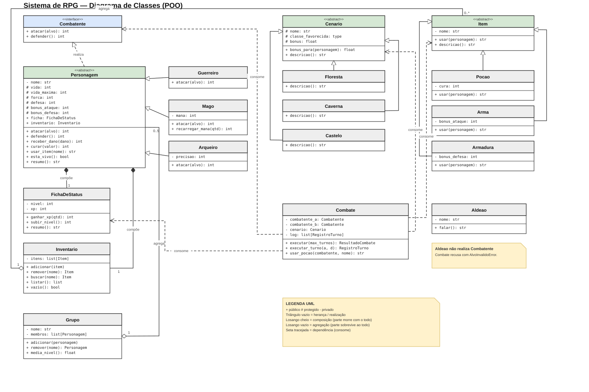
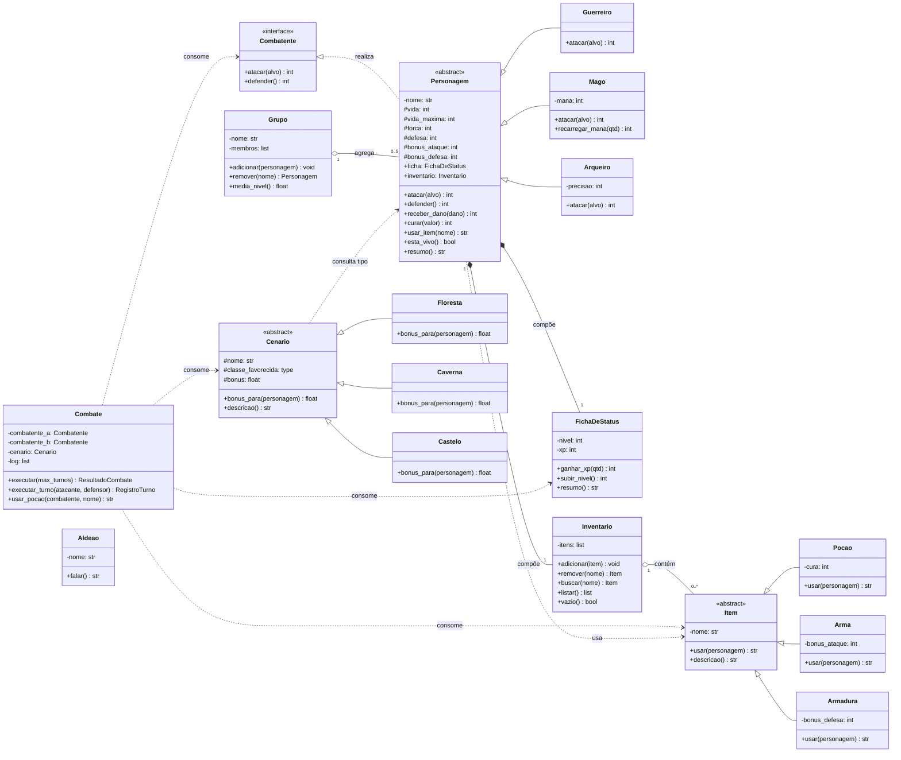

# Diagrama de Classes — Sistema de RPG

> Notação: UML 2.x. O diagrama está em Mermaid (renderiza no GitHub) e repetido em
> ASCII para impressão. Cada símbolo é mapeado para o código em
> [`rastreabilidade.md`](rastreabilidade.md).

---

## 1. Arquivos do diagrama

| Arquivo | Formato | Uso |
|---|---|---|
| [`diagrama-classes.drawio`](diagrama-classes.drawio) | XML `mxfile` (draw.io / diagrams.net) | **editável** — abra em <https://app.diagrams.net> (File → Open) ou no VS Code com a extensão *Draw.io Integration* |
| [`diagrama-classes.svg`](diagrama-classes.svg) | SVG vetorial | visualização rápida no navegador/GitHub, sem instalar nada |



O XML entregue foi validado (parse, ids únicos e referências `source`/`target`) e abre
em <https://app.diagrams.net> em *File → Open*.

---

## 2. Diagrama (Mermaid)



---

## 3. Diagrama em ASCII

```
                        <<interface>>
                         Combatente
                    + atacar(alvo) int
                    + defender() int
                          ^
                          | realiza
                          |
                     <<abstract>>
                      Personagem
        - nome: str   # vida: int   # forca: int   # defesa: int
        + atacar(alvo) int   + receber_dano(dano) int   + usar_item(nome)
                          ^
          +---------------+---------------+
          |               |               |
      Guerreiro         Mago          Arqueiro
      (atacar x2)   (- mana)        (- precisao)

     Personagem 1 ◆── 1 FichaDeStatus      (composição: nasce junto)
     Personagem 1 ◆── 1 Inventario         (composição: nasce junto)
     Inventario 1 ◇── 0..* Item            (os itens existem fora)
     Grupo      1 ◇── 0..5 Personagem      (agregação: personagem sobrevive)

                      <<abstract>>
                         Item
                 - nome: str
                 + usar(personagem) str
                          ^
          +---------------+---------------+
          |               |               |
        Pocao           Arma          Armadura
      (- cura)      (- bonus_ataque) (- bonus_defesa)

                      <<abstract>>
                        Cenario
            # classe_favorecida: type   # bonus: float
              + bonus_para(personagem) float
                          ^
          +---------------+---------------+
          |               |               |
       Floresta         Caverna        Castelo
      (favorece       (favorece      (favorece
       Arqueiro)      Guerreiro)       Mago)

  Combate ──consome──> Combatente
  Combate ──consome──> Cenario        (aplica bônus de +20%)
  Combate ──consome──> Item           (poção usada no turno)
  Combate ──consome──> FichaDeStatus  (XP do vencedor)
  Cenario ──consulta──> Personagem    (isinstance do tipo favorecido)

  Aldeao  (NÃO realiza Combatente)  ──> recusado em Combate
```

---

## 4. Legenda de notação → código

| Símbolo UML | Significado no projeto | Onde aparece no código |
|---|---|---|
| `<<interface>>` + `<\|\|..` | contrato implementado por `Personagem` | `interfaces.py` / `personagem.py` |
| `<<abstract>>` | classe com `ABC` + `@abstractmethod` | `Personagem`, `Item`, `Cenario` |
| `<\|\|--` | herança (`class Filha(Mae)`) | `Guerreiro`, `Mago`, `Arqueiro` etc. |
| `*--` (losango cheio) | composição: parte criada no construtor | `FichaDeStatus`, `Inventario` |
| `o--` (losango vazio) | agregação: parte recebida de fora | `Grupo → Personagem`, `Inventario → Item` |
| `..>` (tracejada) | consumo/dependência de classe | `Combate → Combatente/Cenario/Item` |
| `-` | privado (`_atributo`) | nome, mana, precisao, itens |
| `#` | protegido (`_atributo` acessado por subclasse) | vida, forca, defesa |
| `+` | público | todos os métodos da API |

---

## 5. Multiplicidades

| Relação | Multiplicidade | Leitura |
|---|---|---|
| `Personagem` ◆— `FichaDeStatus` | 1 — 1 | todo personagem tem exatamente uma ficha, criada com ele |
| `Personagem` ◆— `Inventario` | 1 — 1 | todo personagem tem exatamente um inventário, criado com ele |
| `Grupo` ◇— `Personagem` | 1 — 0..5 | um grupo referencia até cinco personagens que existem fora dele |
| `Inventario` ◇— `Item` | 1 — 0..* | um inventário guarda vários itens criados fora dele |

---

## 6. Por que cada relação é o que é

| Relação | Teste aplicado | Resultado |
|---|---|---|
| `Personagem` → `FichaDeStatus` | "a ficha sobrevive sem o personagem?" | **Não** → composição |
| `Personagem` → `Inventario` | "o inventário sobrevive sem o personagem?" | **Não** → composição |
| `Grupo` → `Personagem` | "o personagem sobrevive se o grupo acabar?" | **Sim** → agregação |
| `Inventario` → `Item` | "a poção existe antes de ser guardada?" | **Sim** → agregação |
| `Guerreiro` → `Personagem` | "guerreiro **é um** personagem?" | **Sim** → herança |
| `Personagem` → `Combatente` | "apenas promete assinaturas?" | **Sim** → realização |
| `Combate` → `Personagem` | "apenas usa a API?" | **Sim** → dependência |
