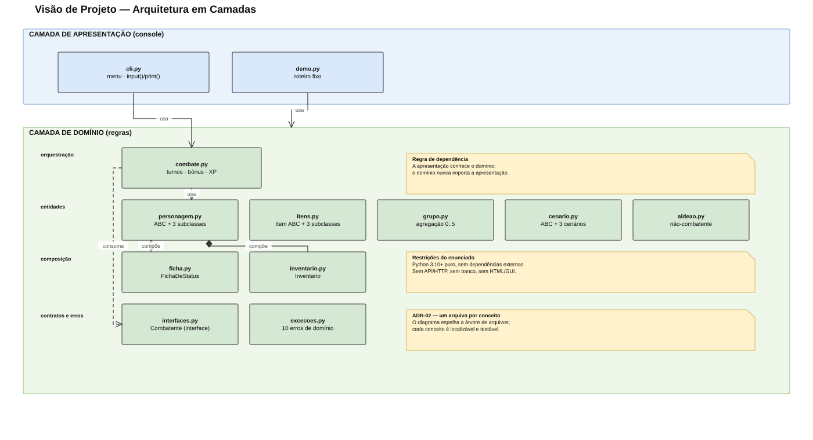

# Visão de Projeto — Sistema de RPG (POO)

**Disciplina:** Programação Orientada a Objetos — Univassouras
**Entrega:** caso de uso, visão de projeto, diagrama de classes e implementação em console.

---

## 1. Visão geral

O sistema é um **RPG de console** no qual o jogador cria personagens, equipa itens,
monta grupos, escolhe um cenário e resolve combates por turnos. Não existe servidor,
API, banco de dados nem interface gráfica: toda a interação é `input()`/`print()`.

O projeto foi organizado para que **cada conceito da disciplina ocupe um arquivo próprio**.
Isso torna a correção objetiva: o professor aponta o conceito e o arquivo correspondente
(o mapa completo está em [`rastreabilidade.md`](rastreabilidade.md)).

```
RPG_POO/
├── rpg/                   # domínio + aplicação de console
│   ├── excecoes.py        # A08 — hierarquia de exceções
│   ├── interfaces.py      # A06 — contrato Combatente
│   ├── itens.py           # A05/A08 — Item abstrato + 3 subclasses
│   ├── ficha.py           # A07 — composição
│   ├── inventario.py      # A07 — composição
│   ├── personagem.py      # A02/A03/A05/A08 — abstração, herança, polimorfismo
│   ├── aldeao.py          # A06 — objeto que NÃO é Combatente
│   ├── grupo.py           # A07 — agregação
│   ├── cenario.py         # A04/A06 — regra de negócio do ambiente
│   ├── combate.py         # A03/A06/A08 — consumo de classe e orquestração
│   ├── cli.py             # A01 — aplicação de console
│   └── __main__.py        # ponto de entrada: python -m rpg
├── testes/                # A09 — unittest, padrão Arrange-Act-Assert
├── docs/                  # caso de uso, visão, diagrama, rastreabilidade
├── demo.py                # demonstração roteirizada (evidência executável)
└── regras.md              # enunciado original
```

---

## 2. Arquitetura

Separação em duas camadas, sem framework:

```
+--------------------------------------------------------------+
|  CAMADA DE APRESENTAÇÃO (console)                            |
|  cli.py  ->  lê input(), cria objetos, chama o domínio        |
|  demo.py ->  roteiro fixo, mesma API, saída determinística    |
+-------------------------------+------------------------------+
                                | usa
+-------------------------------v------------------------------+
|  CAMADA DE DOMÍNIO (regras)                                  |
|  combate.py  -> orquestra turnos, aplica bônus de cenário     |
|  personagem.py / grupo.py / cenario.py / itens.py            |
|  ficha.py / inventario.py / aldeao.py                        |
|  excecoes.py / interfaces.py  -> contratos e erros           |
+--------------------------------------------------------------+
```

Regra de dependência: **a apresentação conhece o domínio; o domínio nunca importa a
apresentação**. O domínio não chama `input()` nem `print()` (exceto `Combate`, que
acumula log em lista — quem imprime é a CLI).

### 2.1 Diagrama de camadas (draw.io)

Arquivos do diagrama:

| Arquivo | Uso |
|---|---|
| [`diagrama-visao-de-projeto.drawio`](diagrama-visao-de-projeto.drawio) | editável no draw.io / diagrams.net |
| [`diagrama-visao-de-projeto.svg`](diagrama-visao-de-projeto.svg) | pré-visualização versionada |



Como ler:

- **Faixa superior — apresentação:** `cli.py` e `demo.py` são a única porta de entrada
  (`input()`/`print()`); não contêm regra de negócio.
- **Faixa inferior — domínio:** dividido por responsabilidade, não por subpacote
  (todos os arquivos vivem em `rpg/`, um conceito por arquivo):
  - **orquestração** — `combate.py`: turnos, bônus de cenário, XP;
  - **entidades** — `personagem.py`, `itens.py`, `grupo.py`, `cenario.py`, `aldeao.py`;
  - **composição** — `ficha.py`, `inventario.py` (nascem dentro do personagem);
  - **contratos e erros** — `interfaces.py` (`Combatente`), `excecoes.py` (10 erros).
- **Setas:** `usa` (dependência de chamada), `diamante` (composição) e `consome`
  (dependência de contrato). Nenhuma seta sobe do domínio para a apresentação — é a
  regra de dependência em forma de desenho.
- As notas registram as restrições do enunciado e o ADR-02 (um arquivo por conceito).

---

## 3. Classes do domínio

### 3.1 `Personagem` (abstrata — A02/A05)

Não pode ser instanciada. Define o estado e o comportamento comuns.

| Membro | Tipo | Visibilidade | Papel |
|---|---|---|---|
| `nome` | `str` | privado (`-`) | identidade |
| `vida` / `vida_maxima` | `int` | protegido (`#`) | estado vital, usado por subclasses |
| `forca` | `int` | protegido | base do dano |
| `defesa` | `int` | protegido | mitigação |
| `ficha` | `FichaDeStatus` | público (`+`) | **composição** criada no construtor |
| `inventario` | `Inventario` | público | **composição** criada no construtor |
| `atacar(alvo)` | `int` | público | abstrato — cada subclasse decide o poder |
| `defender()` | `int` | público | ativa postura defensiva, retorna defesa |
| `receber_dano(dano)` | `int` | público | valida, mitiga e limita a 0 |
| `curar(valor)` | `int` | público | limita à vida máxima |
| `usar_item(nome)` | `str` | público | delega ao `Item` (polimorfismo) |
| `esta_vivo()` | `bool` | público | consulta |
| `resumo()` | `str` | público | representação textual |

### 3.2 `Combatente` (interface — A06)

Contrato explícito, sem implementação:

```
<<interface>>
Combatente
+ atacar(alvo: Combatente) -> int
+ defender() -> int
```

`Personagem` **realiza** a interface (linha tracejada no diagrama). Quem não a realiza
(`Aldeao`) é recusado pelo `Combate` com `AlvoInvalidoError` — o contrato tem dentes.

### 3.3 Herança de personagens (A08)

| Subclasse | Diferencial | `atacar()` |
|---|---|---|
| `Guerreiro` | vida 120, defesa 12, forca 18 | `(força + bônus de arma) * 2` (golpe pesado) |
| `Mago` | vida 80, defesa 6, forca 14, `mana` 40 | `força + bônus + mana // 2`, consome 5 de mana (`SemManaError`) |
| `Arqueiro` | vida 95, defesa 8, forca 15, `precisao` 6 | `força + bônus + precisão` |

Cada uma chama `super().__init__(...)` e **sobrescreve** `atacar()`; o polimorfismo é
exercido quando o `Combate` chama `atacante.atacar(defensor)` sem saber o tipo concreto.

### 3.4 `Item` (abstrata) e subclasses (A05/A08)

```
Item (abstract) -nome: str
  + usar(personagem: Personagem) -> str   # abstrato
       ^            ^             ^
   Pocao         Arma         Armadura
   cura          bonus_ataque  bonus_defesa
```

- `Pocao.usar` → `personagem.curar(cura)`; é consumida.
- `Arma.usar` → soma `bonus_ataque` ao personagem; permanece equipada.
- `Armadura.usar` → soma `bonus_defesa`; permanece equipada.

### 3.5 `FichaDeStatus` e `Inventario` (composição — A07)

Ambos são **criados dentro do construtor** de `Personagem` e não são passados de fora.
Se o personagem deixa de existir, a ficha e o inventário deixam de existir com ele.

| Classe | Estado | Operações |
|---|---|---|
| `FichaDeStatus` | `nivel`, `xp` | `ganhar_xp(qtd)`, `subir_nivel()`, `resumo()` |
| `Inventario` | `itens: list[Item]` | `adicionar`, `remover`, `buscar`, `listar`, `vazio` |

### 3.6 `Grupo` (agregação — A07)

Recebe `Personagem` já criados. Limite de 5 membros. Dissolver o grupo **não** destrói
os personagens — por isso o losango é **vazio** no diagrama.

| Membro | Papel |
|---|---|
| `nome` | identidade do grupo |
| `membros` | lista de referências (não cópias) |
| `adicionar(personagem)` | `GrupoCheioError`, `AlvoInvalidoError` |
| `remover(nome)` | `AlvoInvalidoError` se não for membro |
| `media_nivel()` | indicador do grupo |

### 3.7 `Cenario` (abstrata) — ambiente que favorece o usuário (RN06)

| Cenário | Tipo favorecido | Bônus |
|---|---|---|
| `Floresta` | `Arqueiro` | +20% |
| `Caverna` | `Guerreiro` | +20% |
| `Castelo` | `Mago` | +20% |

`Cenario.bonus_para(personagem)` **consome** `Personagem` (usa `isinstance` sobre a
hierarquia) e devolve o multiplicador. O cenário não altera o personagem: quem aplica
o bônus é o `Combate`.

### 3.8 `Combate` — orquestração e consumo de classe (A03/A06/A08)

| Membro | Papel |
|---|---|
| `combatente_a`, `combatente_b` | referências que **consomem** `Combatente` |
| `cenario` | consome `Cenario` |
| `executar(max_turnos=50)` | laço de turnos, retorna `ResultadoCombate` |
| `executar_turno(atacante, defensor)` | aplica bônus do cenário, chama `atacar`/`receber_dano` |
| `usar_pocao(combatente, nome)` | consome `Item` do inventário durante a luta |
| `log` | lista de `RegistroTurno` para auditoria |

`Combate` **não** implementa as regras de dano: ele **usa** `atacar()` e `receber_dano()`
de `Personagem`. Isso é o *consumo de classe* exigido: a relação de uso está documentada,
não implícita.

### 3.9 `Aldeao`

`Aldeao(nome)` possui `falar()` e **não** realiza `Combatente`. Existe para provar que
participar de combate exige cumprir o contrato.

---

## 4. Consumo de classe (tabela explícita)

| Consumidor | Consome | Como |
|---|---|---|
| `cli.py` | todas as classes do domínio | cria objetos e chama métodos |
| `Combate` | `Combatente` | `atacante.atacar(defensor)` |
| `Combate` | `Cenario` | `cenario.bonus_para(atacante)` |
| `Combate` | `Item` | `item.usar(personagem)` via `usar_pocao` |
| `Combate` | `FichaDeStatus` | `ficha.ganhar_xp(...)` |
| `Cenario` | `Personagem` | `isinstance(personagem, classe_favorecida)` |
| `Grupo` | `Personagem` | guarda referências e lê `nome`/`ficha.nivel` |
| `Personagem` | `Item` | `usar_item` chama `item.usar(self)` |
| `Personagem` | `Inventario` / `FichaDeStatus` | composição: chama `adicionar`, `ganhar_xp` |
| `Pocao` / `Arma` / `Armadura` | `Personagem` | `personagem.curar(...)`, `receber_bonus_*` |

---

## 5. Tratamento de exceções (A08)

```
RPGError (Exception)
├── ValorInvalidoError      # nome vazio, bônus negativo, XP negativo
├── VidaInvalidaError       # vida inicial <= 0
├── DanoInvalidoError       # dano <= 0 em receber_dano
├── ItemNaoEncontradoError  # item ausente no inventário
├── GrupoCheioError         # 6º membro
├── AlvoInvalidoError       # personagem/não-combatente inválido
├── PersonagemMortoError    # agir com vida 0
├── SemManaError            # mago sem mana para atacar
├── CenarioInvalidoError    # opção de cenário inexistente
└── CombateInfinitoError    # estourou o limite de turnos
```

Regra de uso: **a CLI captura `RPGError` e mostra a mensagem; o domínio nunca engole
exceção**. Testes verificam cada `raise` com `assertRaises`.

---

## 6. Fluxo principal (visão de execução)

```
Jogador                CLI                  Domínio
   |                    |                      |
   |-- 1 criar -------->|                      |
   |                    |-- Guerreiro("Aragorn") --> Personagem.__init__
   |                    |                      |    +-- FichaDeStatus()   (composição)
   |                    |                      |    +-- Inventario()      (composição)
   |<-- ficha ----------|                      |
   |-- 2 poção -------->|-- Pocao("Poção",30) -> Inventario.adicionar
   |-- 3 grupo -------->|-- Grupo.adicionar(personagem)   (agregação)
   |-- 4 cenário ------>|-- Caverna()          (favorece Guerreiro)
   |-- 5 combate ------>|-- Combate(a,b,Caverna).executar()
   |                    |                      |    turno: a.atacar(b) [x1.2]
   |                    |                      |           b.receber_dano(dano)
   |<-- log + XP -------|                      |    ficha.ganhar_xp(100) -> nível 2
```

---

## 7. Decisões de projeto (ADRs leves)

**ADR-01 — Console puro, sem framework.**
Prós: atende a restrição do enunciado; zero instalação; foco no domínio.
Contras: sem validação automática de entrada.
Decisão: aceito.

**ADR-02 — Um arquivo por conceito, em vez de um único `rpg.py`.**
Prós: o diagrama espelha a árvore de arquivos; cada conceito é localizável.
Contras: mais imports.
Decisão: aceito (a rastreabilidade é critério de avaliação).

**ADR-03 — `Item` também é abstrata.**
Prós: demonstra abstração em dois níveis (personagem e item) e polimorfismo em `usar()`.
Contras: um pouco mais de código.
Decisão: aceito.

**ADR-04 — Bônus de cenário aplicado pelo `Combate`, não pelo `Personagem`.**
Prós: mantém o personagem ignorante do ambiente (baixo acoplamento) e evidencia o
consumo `Combate → Cenario`.
Contras: um passo extra no cálculo do dano.
Decisão: aceito.

---

## 8. Como executar

```bash
python -m rpg                          # menu interativo de console
python demo.py                         # demonstração roteirizada (evidência)
python -m unittest discover -s testes -v
```
